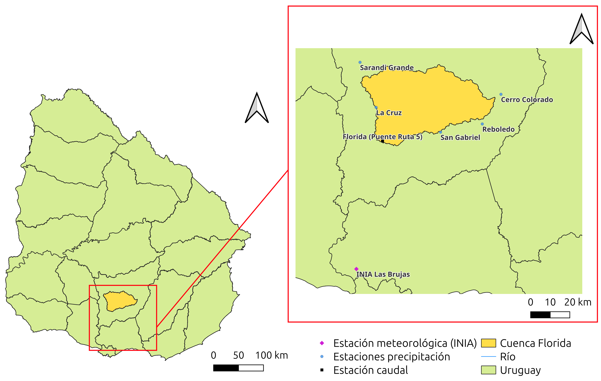
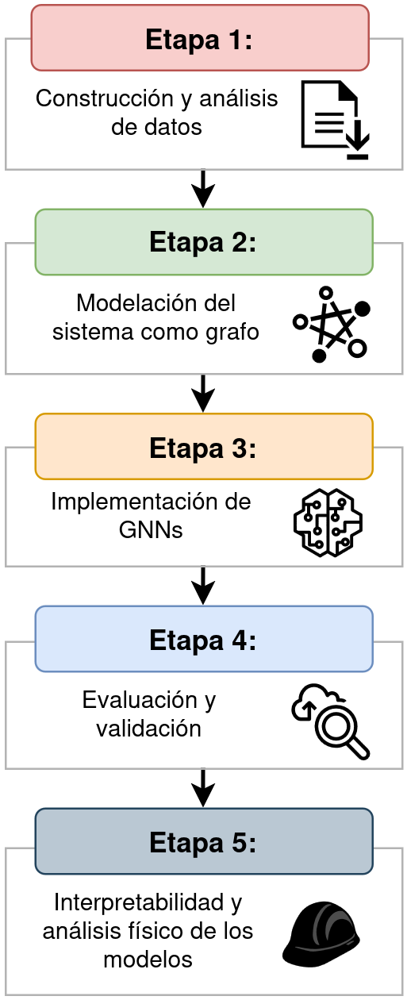
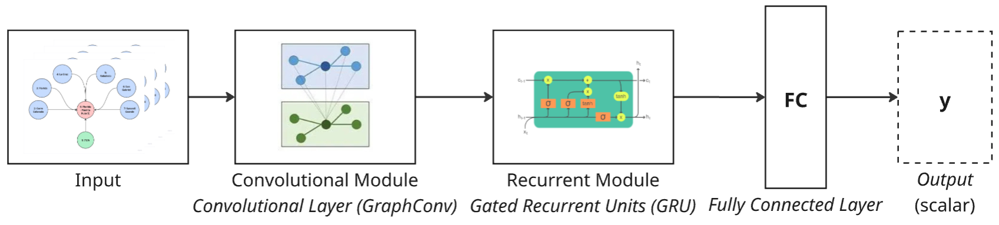

# Graph Neural Networks for Streamflow Prediction in the Santa Lucía Chico Basin

Forecasting daily streamflow at the **Florida (Puente Ruta 5)** gauging station (Santa Lucía Chico basin, Uruguay) by representing the monitoring network as a **graph**: stations and measured variables become nodes, and their spatial relationships become (optionally distance-weighted) edges. Built with PyTorch Geometric and tuned with Optuna.

Project developed for the *Taller de Sistemas Ciber-Físicos* (TSC-F) course at the Facultad de Ingeniería, Universidad de la República (Uruguay).

<p align="center">
  
</p>

## Highlights

- **13 graph topologies** that encode different hypotheses about how precipitation and meteorological stations relate to the target gauge, with unweighted and inverse-distance-weighted (IDW) edges.
- **8 GNN architectures** implemented from scratch on top of PyG: graph convolution (`GraphConv`), graph attention (`GATv2Conv`), temporal attention, and GRU-based recurrent variants, plus combinations of these.
- **Windowed spatio-temporal inputs**: each sample is a graph whose nodes carry a 36-day window of daily features; the target is next-day streamflow at the Florida node.
- **Hyperparameter search** with Optuna (optimizer, learning rate, hidden size, dropout), runnable on a SLURM cluster.
- Evaluated with the Nash–Sutcliffe efficiency (NSE) on a chronological hold-out set and compared against the best model of [Vilaseca et al. (2023)](https://doi.org/10.1080/02626667.2023.2232356).

## Method

<p align="center">
  
</p>

1. **Data construction and analysis**: daily streamflow (DINAGUA), precipitation stations and meteorological variables from INIA Las Brujas (temperature, humidity, wind, radiation, evapotranspiration, heliophany), 2011–2022. Missing-data analysis and imputation live in [`notebooks/01_data_preparation.ipynb`](notebooks/01_data_preparation.ipynb).
2. **Graph modelling**: edge lists for every topology are defined in [`source/graphs.py`](source/graphs.py) (`GRAPH_DEFINITIONS`). Variants 5–10 use mean areal precipitation (MAP) over the basin; the others use the individual stations. Edge weights are IDW on station distance.
3. **GNN implementation**: the architectures are in [`source/models.py`](source/models.py). Time steps are folded into a single large graph so a whole window is processed in one convolution call.
4. **Evaluation**: chronological 80/20 train/test split, MinMax scaling fitted on the training set only, NSE as metric.
5. **Interpretability**: Captum attributions over variables, nodes and time steps.

### Example architecture (graph convolution → GRU)

<p align="center">
  
</p>

| Model name | Architecture |
|---|---|
| `conv` | `GraphConv` over the flattened window → fully connected head |
| `attention` | `GATv2Conv` (4 heads) → mean over time → head |
| `attentionConv` | `GraphConv` → `GATv2Conv` → mean over time → head |
| `recursive` | `GraphConv` per time step → GRU over the window → head |
| `recursiveAttention` | `GATv2Conv` per time step → GRU over the window → head |
| `onlyRecursive` | GRU on each node, no message passing (non-graph reference) |
| `temporalAttention` | `GATv2Conv` per time step → temporal 1-D convolution → head |
| `temporalAttentionConv` | `GraphConv` + `GATv2Conv` per time step → temporal 1-D convolution → head |

Each model is trained in four variants (`v1`–`v4`), the combinations of **edge weights on/off** and, for the attention-based models, **attention-head concatenation vs. averaging**.

## Results

These results show the top 10 models compared with the fine-tuned Random Forest baseline from Vilaseca et al. (2023). Performance could be further improved through hyperparameter tuning.

| Model | Graph | NSE Train | NSE Test |
|---|---|---:|---:|
| Attention + Recurrence | Graph 6 v4 | 0.91 | **0.82** |
| Recurrence + Conv. | Graph 6 v2 | 0.83 | **0.80** |
| Temporal Attention + Conv. | Graph 8 v3 | 0.93 | **0.80** |
| Temporal Attention + Conv. | Graph 6 v3 | 0.95 | **0.80** |
| Temporal Attention | Graph 6 v2 | 0.88 | 0.79 |
| Temporal Attention + Conv. | Graph 8 | 0.92 | 0.78 |
| Temporal Attention + Conv. | Graph 2 v2 | 0.93 | 0.78 |
| Attention + Recurrence | Graph 6 v3 | 0.90 | 0.78 |
| Attention + Recurrence | Graph 6 | 0.89 | 0.77 |
| Attention + Recurrence | Graph 10 v4 | 0.86 | 0.77 |
| Baseline RF (Vilaseca et al. 2023) | — | 0.84 | 0.69 |

In every pair, adding a self-loop on the target node substantially improves the test NSE. In this codebase a self-loop on the Florida node means the station's own **past streamflow is fed to the model as an input** (autoregressive); without it, streamflow is masked and the model has to infer it from precipitation and meteorological stations alone. So the table mostly quantifies how much the autoregressive signal helps, which is why the non-autoregressive graphs (5, 7, 9, 11) are the harder and more interesting benchmark. Results of the full architecture × graph × weighting grid come from the cluster scripts (see [`cluster_scripts/`](cluster_scripts/)); they are written to a results directory of your choice and are not versioned in this repository.

## Repository structure

```
slc-gnns/
├── source/                  # Library code
│   ├── graphs.py            # graph topologies, IDW edge weights, windowed dataset builder
│   ├── models.py            # GNN architectures, train/test loops, Optuna objective
│   ├── gnn_training.py      # model search and final training pipeline
│   ├── training_config.py   # epochs, split ratios, target station/variable
│   └── utils.py
├── cluster_scripts/         # CLI entry point + SLURM/Optuna job scripts
├── notebooks/               # Exploration and analysis (numbered in reading order)
│   ├── 01_data_preparation.ipynb
│   ├── 02_graph_variants_exploration.ipynb
│   ├── 03_model_prototyping.ipynb
│   ├── 04_plot_level_vs_flow.ipynb
│   ├── 05_plot_scatterplots.ipynb
│   └── archive/             # earlier iterations, kept for reference
├── data/input_data/         # Processed parquet datasets + station coordinates
├── images/                  # Figures used in this README
├── environment/             # Conda/mamba setup script and full pinned freeze
└── requirements.txt         # Core dependencies
```

## Getting started

```bash
git clone https://github.com/pedrooopp/slc-gnns.git
cd slc-gnns

python -m venv .venv && source .venv/bin/activate
pip install -r requirements.txt
```

If PyTorch Geometric needs extra wheels for your CUDA/PyTorch combination, follow the [PyG installation guide](https://pytorch-geometric.readthedocs.io/en/latest/install/installation.html). `environment/requirements-freeze.txt` is the exact environment used during development (CUDA 13 build) and is provided for reference only.

Train a model on a few graph variants:

```bash
export PYTHONPATH=$(pwd)
python cluster_scripts/gnn_streamflow_cluster.py \
    --model recursive --weight-type idw \
    --experiment-mode selective -gvp "Grafo 6 v2, Grafo 12" \
    --results-dir results/recursive --data-dir data/input_data
```

Available models: `conv`, `attention`, `attentionConv`, `recursive`, `recursiveAttention`, `onlyRecursive`, `temporalAttention`, `temporalAttentionConv`. See [`cluster_scripts/README.md`](cluster_scripts/README.md) for cluster usage.

## Reference

Vilaseca et al. (2023). *Hydrological Sciences Journal*. https://doi.org/10.1080/02626667.2023.2232356

